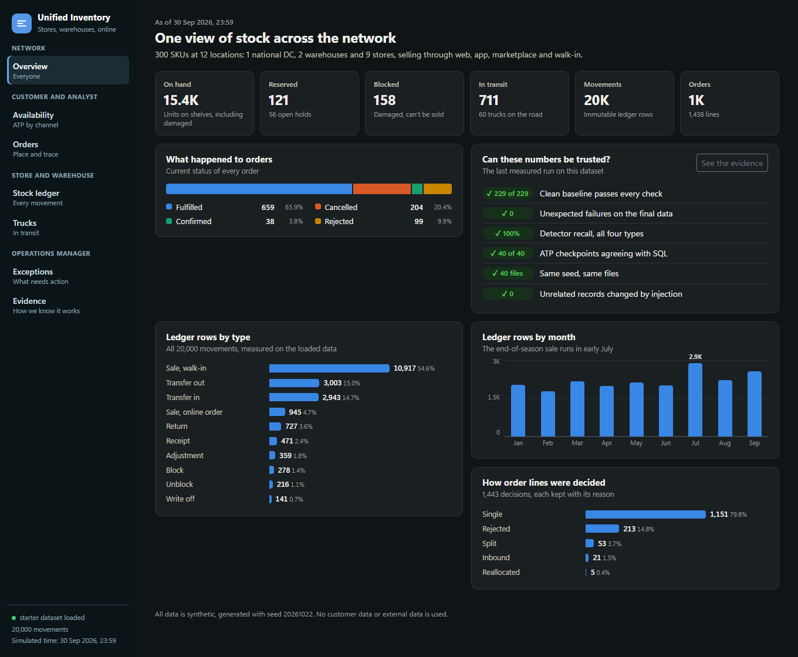
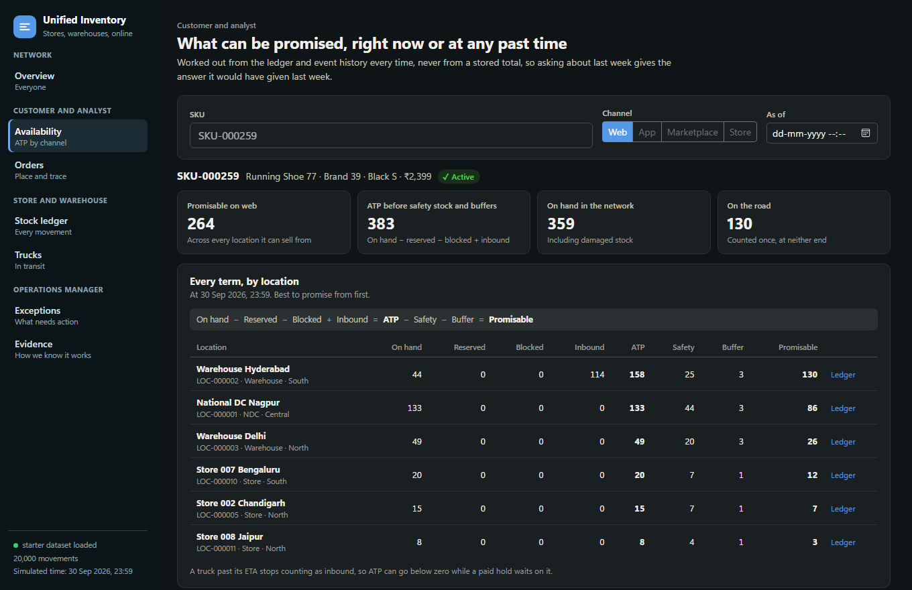
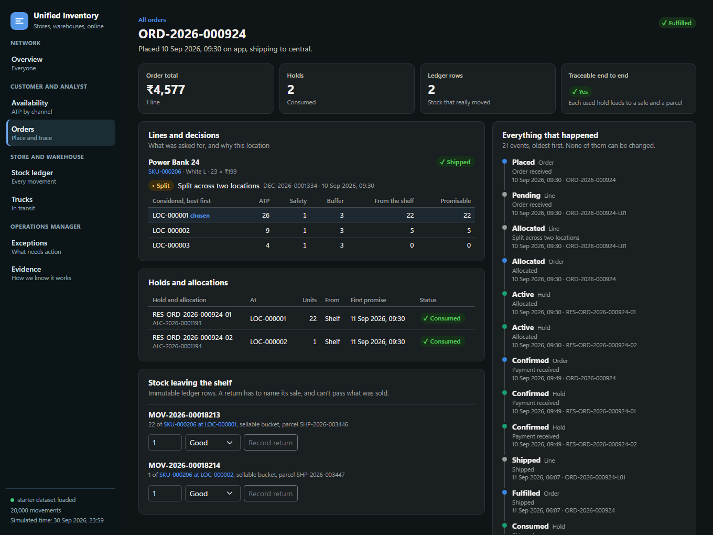
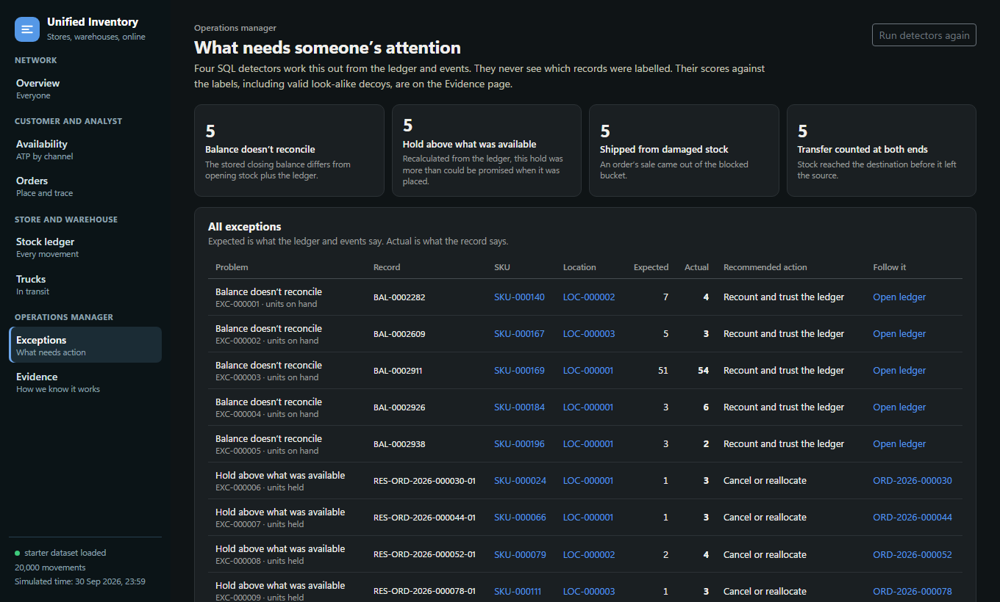

# Unified Inventory

One view of stock across stores, warehouses and online channels, accounting for reservations,
safety stock and stock on trucks. Built for the YottaFlex AI code challenge. The full brief is in
[docs/brief.md](docs/brief.md).



## The problem

A retailer sells the same units through a website, an app, a marketplace and its own shops, from a
national DC, regional warehouses and stores. To promise stock honestly it has to answer one question
at any moment: how much of this SKU can this channel sell, here, right now?

That answer depends on what is on the shelf, what is damaged, what is held for unpaid orders, and what
is on a truck. It also has to survive two customers wanting the last unit at the same second, a truck
running late with a paid order on it, and records that quietly disagree with each other.

This project is that system, on generated data:

- **An immutable ledger** of 1,000,000 stock movements and 50,000 online orders, all synthetic.
- **ATP worked out from history** at any point in time, never from a stored total.
- **Locked allocation**, so two orders can't take the same last unit.
- **Four detectors** for the problems the brief names, scored against a ground truth they never see.
- **A traceable chain** from each order to its decision, hold, parcel and ledger row.
- **A site** with a view for each actor in the brief, on real data from the API.

## Quick start

You need Python 3.12, Node 20 or later, and Docker. These are PowerShell commands, from the repo root.

**1. Start the database.** It runs on port 5434, so it can sit beside another PostgreSQL.

```powershell
docker compose up -d
```

**2. Install the backend and set up its settings.**

```powershell
cd backend
python -m venv venv
.\venv\Scripts\python.exe -m pip install -r requirements.txt
Copy-Item .env.example .env
```

**3. Generate, load, validate, detect and measure everything.** About 35 seconds.

```powershell
.\venv\Scripts\python.exe -m scripts.run_all --scale starter
```

**4. Start the API.** Leave this running.

```powershell
.\venv\Scripts\python.exe -m uvicorn app.main:app --port 8000
```

**5. Start the site, in a second terminal, from the repo root.**

```powershell
cd frontend
npm install
npm run dev
```

Open <http://localhost:5173>. The API's own documentation is at <http://localhost:8000/docs>.

Placing orders on the site really writes to the database. To go back to the original data, run step 3 again.

### The full 1,000,000 movements

One command, about 15 minutes on the laptop this was built on, of which 5 are generating it twice more
to compare. The full data is too large for Git, and this recreates it byte for byte.

```powershell
.\venv\Scripts\python.exe -m scripts.run_all --scale full
```

Restart the API after this if it was running. It finds which dataset is loaded by itself.

## How to verify it

Run these from `backend`. The tests use their own databases, so they can't touch what is loaded.

```powershell
.\venv\Scripts\python.exe -m pytest
```

Each step of `run_all` can also run on its own. Write `.\venv\Scripts\python.exe` where these say `python`, unless the venv is activated:

| Command | What it shows |
|---|---|
| `python -m scripts.generate --scale starter --seed 20261022` | Writes the clean baseline, the final data and the answers, each in its own folder |
| `python -m scripts.load_data --scale starter --clean` | Loads the clean baseline |
| `python -m scripts.validate --scale starter --clean` | Every check passes, exit 0 |
| `python -m scripts.load_data --scale starter` | Loads the final data, with its labelled problems |
| `python -m scripts.validate --scale starter` | Fails on purpose, exit 1, listing the failing record IDs |
| `python -m eval.check_failures --scale starter` | Those IDs match the labelled IDs exactly, exit 0 |
| `python -m scripts.run_detect` | The four detectors fill `inventory_exception` |
| `python -m eval.score --scale starter` | Precision and recall per type |
| `python -m eval.check_atp --scale starter` | ATP worked out a second way agrees with SQL |
| `python -m eval.check_unrelated --scale starter` | Injecting the cases changed nothing else |
| `python -m scripts.compare_runs --scale starter` | Same seed twice, every file compared byte for byte |
| `python -m eval.report --scale starter` | Writes `metrics_summary.json`, which the site shows |
| `python -m eval.try_seeds --first 1 --count 20` | Runs all of it on other seeds |
| `python -m scripts.export_seed --scale starter` | The same tables as SQL and JSON |

The starter data is committed in `backend/data/starter/`, its answers in
`backend/data/ground_truth/starter/`, and the last full-scale results in
[docs/results/full_metrics_summary.json](docs/results/full_metrics_summary.json).

## What it looks like

| Who | Page | What it answers |
|---|---|---|
| Customer, analyst | Availability | Every term of the formula per location, by channel, at any past time |
| Customer | Orders | Place an order and see the decision, or the refusal and its reason |
| Everyone | Order trace | Order, line, decision, hold, parcel, ledger row and every event in time order |
| Store or warehouse operator | Stock ledger | Every movement of a SKU at a location, with stock after each row |
| Store or warehouse operator | Trucks | What is on the road, and receive or delay a truck |
| Operations manager | Exceptions | What the detectors found, with expected, actual and recommended action |
| Operations manager, reviewer | Evidence | All the measured results below, served from the last run |







## How we know it works

All numbers below were measured on seed 20261022, on the laptop this was built on.

| | Starter | Full |
|---|---|---|
| SKUs and locations | 300 and 12 | 5,000 and 100 |
| Movements, exact | 20,000 | 1,000,000 |
| Orders, exact | 1,000 | 50,000 |
| Clean baseline, checks passed | 229 of 229 | 229 of 229 |
| Final data, checks passed | 223 of 229 | 224 of 229 |
| Unexpected failures | 0 | 0 |
| Same seed twice | All 40 files identical | All 40 files identical |
| Clean rows changed by injection | 0 | 0 |
| ATP checkpoints agreeing with SQL | 40 of 40 | 200 of 200 |
| Oversell attempts refused | 20 of 20 | 1,513 of 1,513 |
| Allocations traceable to their line and hold | 1,283 of 1,283 | 68,362 of 68,362 |
| Used holds leading to a sale and a parcel | 945 of 945 | 52,464 of 52,464 |
| **Order decisions recalculated in SQL** | 200 of 1,438 in the normal run. Every one was also checked once: only the 5 labelled ones differ | **Only 200 of 72,360** |

**The failures on the final data are on purpose.** The validator fails on the labelled problems, and
`run_all` would stop if it didn't. It doesn't read the labels. A separate command compares the failing
record IDs with the labelled IDs, so one missed label and one unrelated failure can't cancel each other
out. A missing check, or a check that reports no IDs, also counts as a failure.

**Detector scores.** Every type at both scales: precision 100%, recall 100%, none of the decoys flagged,
and nothing flagged on the clean baseline. Labelled problems per type: 5 at starter and 50 at full, with
the same number of decoys.

**Don't read 100% as real-world accuracy.** The anomalies and the detectors come from the same author,
and each detector tests the exact rule its anomaly breaks. So it shows they are consistent. The stronger
evidence is that the decoys aren't flagged, the clean baseline flags nothing, and ATP worked out two
separate ways agrees.

**Tests.** All 777 tests pass, in about 9 minutes, including 20 orders racing for one unit through the
API. Separately, bugs were introduced on purpose in a scratch copy to see whether the tests notice. That was
done for each step as it was built, 172 bugs in all, and each was caught, some only after a test was added
for it. Those lists were not rerun together on the final code.

| How long, at full scale | Seconds |
|---|---|
| Generate all three folders | 131 |
| Load, with foreign keys and indexes | 51 |
| Validate, with 200 decisions recalculated | 125 |
| Run the detectors | 61 |
| Compare ATP checkpoints | 25 |
| Generate twice more and compare every file | 321 |
| One ATP answer | Median 97 ms, slowest of 21 SKUs 1.25 s |

## The rules

```
on_hand(t)    = opening on_hand + every movement up to t
blocked(t)    = opening blocked + every BLOCKED movement up to t
reserved(t)   = holds whose latest event up to t is CONFIRMED, or ACTIVE and t < expires_at
inbound(t)    = trucks on the road at t, due within 24 hours, where the rule allows it
ATP(t)        = on_hand(t) - reserved(t) - blocked(t) + inbound(t)
promisable(t) = max(0, ATP counted for this channel - safety stock - channel buffer)
```

| Channel | Counts inbound | Safety stock | Hold before payment |
|---|---|---|---|
| Web, app | Yes | Yes | 30 minutes |
| Marketplace | No | Yes | 120 minutes |
| Store, walk-in | No | No | None |

**Allocation.** Rank locations by same region, then warehouse, NDC and store, then most promisable. Try one
location, then two, then one truck, and otherwise refuse the line and keep the refusal with its reason.

**Two customers at once.** An order finds its candidate SKU-location rows from master data alone, locks them
in sorted order, and only then reads stock in new statements. So it sees what the previous lock holder wrote.

**Late trucks.** Keep the first promise in history, move the hold to a location that has the stock, or update
the promise, or cancel it if it would be more than 3 days past the first promise. A moved hold releases the
old one at the same moment, so stock is never reserved twice.

The complete rules, with examples, are in [docs/PLAN.md](docs/PLAN.md). Every field is in
[docs/DATA_DICTIONARY.md](docs/DATA_DICTIONARY.md), and a test compares that file with the real database.

## The labelled problems

Generated after a clean baseline passes every check. Each goes on a SKU of its own, after that SKU's last
order, so it causes only its own problem.

| Problem | The anomaly | Its decoy, valid but suspicious |
|---|---|---|
| Balance doesn't reconcile | A stored closing balance changed by 1 to 3 units | A pair whose real movements net to exactly zero |
| Reservation exceeds available | A hold above what could be promised, with a stale logged decision | A hold of exactly what could be promised |
| Order fulfilled from blocked stock | A sale from the blocked bucket | A sale from the shelf where blocked stock also sits |
| Transfer counted at both ends | Stock reaches the destination before it leaves the source | A short trip that beats its ETA, having left first |

The answers are in a separate folder, never loaded into the database. Only `backend/eval/` reads them, and a
test fails if the app, the loader, the validator or the detectors ever do.

## Key decisions and tradeoffs

| Decision | Why | What it costs |
|---|---|---|
| Plain SQL through psycopg2, no ORM | Bulk loading and window queries gain little from an ORM, and every query can be read as written | More SQL strings to keep correct |
| ATP worked out from history on every request | A past question gets the answer it would have had, and a stale cache can't oversell | Slower: 1.25 s for the slowest SKU at full scale |
| A fixed simulated clock | The same seed gives the same bytes, and tests have exact answers | Live orders are dated just after the data ends, not at the real time |
| Each order line allocated whole | Simple, and easy to explain | A customer asking for 5 when 4 exist gets none |
| One parcel per location, and an order ships whole | Simple shipping and a clear trace | Items on the shelf can wait for a late truck on another line |
| Reserved includes holds on trucks | Can't oversell | Slightly understates what is free on the shelf, which can lose a sale |
| Baseline first, then inject on quiet SKUs | Each case causes only its own problem | The cases look a little different from normal data, see Limitations |
| A hand-written UI with no chart library | Everything on the page can be explained | Fewer chart features |
| No LLM | The brief has no part that needs one, and it would add randomness | None for this brief |

## Assumptions

Whole units only, in one currency, with prices sized like Indian rupees. Suppliers appear only as documents
on receipts. Returns go back to the location of the sale. Walk-in sales respect online holds, though a real
till may not. A transfer carries one SKU. Walk-in sales cover the store channel in the ledger with no order
row, so all 50,000 orders are online. All data sits inside 2026, because the ID formats carry the year.
Decisions on points the brief leaves open are listed in [docs/PLAN.md](docs/PLAN.md), section 14.

## Limitations

The full list, with measurements, is in [docs/STATUS.md](docs/STATUS.md).

**Other seeds.** Only seed 20261022 has run at full scale. At starter scale, 31 of 40 other seeds pass
everything. Seeds 1, 16 and 20261023 stop with an error rather than place a bad case. Seeds 8, 10, 13, 15, 19 and
20261025 have too few late trucks to produce one kind of outcome, so validation fails, as it should.

**The cases have patterns.** A case truck or order always sits after that SKU's last order. Nothing outside
the anomaly itself picks them out exactly, but filters can narrow them: orders that are the last on their SKU
and have one line are 2,256 of 50,000, of which 200 are cases. The detectors use none of this, but **don't
train a model on this data** to find anomalies.

**Settings chosen to fit the cases.** Half of the SKUs stop getting online orders at a random date, and 8% of
pairs start with damaged stock, to make room for cases. Late-truck rates are set on purpose, so they say nothing
about real carriers.

**Sales are very concentrated.** The top tenth of SKUs takes 91% of units sold at full scale and 85% at
starter. That is more than most retailers would see, and the generator's popularity curve wasn't tuned for it.

**Not built.**

- STORE orders. The API answers 501. Walk-in sales cover that channel in the ledger.
- Live versions of walk-in sales, damage, unblocking, write-offs and adjustments. They exist only in the generator.
- A short pick is refused, and nothing re-allocates it. The generator produces none, so it isn't measured.
- Nothing runs the expiry and overdue jobs on a schedule. They run when asked.
- No login, and no deployment. It is a local demo, and anyone who can reach the API can write to it.
- No automated browser tests. The site was checked by hand in a browser.

**Not load-tested.** Orders race correctly in tests with 20 threads, but nothing measured the API under sustained
traffic. An order holds its locks for about as long as an ATP answer takes, per line.

## Project layout

```
docker-compose.yml         PostgreSQL only, on port 5434
docs/                      The brief, plan, status, data dictionary and checklist
prompt-history/            The prompts, word for word
AI_USAGE.md                How AI was used
backend/
  app/                     The API and the rules: atp, rules, orders, reservations, shipping,
                           transfers, late_trucks, returns, detect, trace, views, main
  generator/               The dataset: master data, simulation, order flow, injection, checkpoints, export
  scripts/                 Commands: run_all, generate, load_data, validate, run_detect, compare_runs
  eval/                    The only code that reads the answers: score, check_failures, check_atp,
                           check_unrelated, try_seeds, report
  db/                      schema.sql, then constraints.sql after loading
  data/starter/            The starter dataset, its manifest and validation summary
  data/ground_truth/       The answers, kept apart from the data
  tests/
frontend/src/              The React site: pages, charts, and one stylesheet
```

## Data source

All data is synthetic and comes from this generator. Brands are invented labels, city names are ordinary place
names, and there is no personal data. `source_manifest.json` beside each dataset records the command, seed,
scale, row counts and checksums.

## How AI was used

See [AI_USAGE.md](AI_USAGE.md) and [prompt-history/](prompt-history/).
